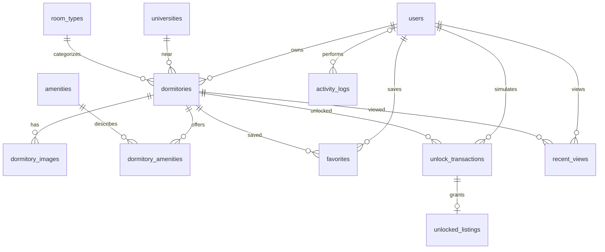

# DormFinder database guide

All tables use InnoDB. Text uses `utf8mb4_unicode_ci`, which makes unique email and reference names case insensitive. Money uses `DECIMAL(10,2)` and is passed to PDO as decimal strings. The PHP `decimal()` helper normalizes values using integer cents; SQL `SUM()` calculates simulated revenue without binary floating-point arithmetic.

| Table | Purpose and relationships |
|---|---|
| `users` | Unique email, password hash, student/owner/admin role, active/inactive account |
| `universities` | Unique university names; referenced by dormitories |
| `room_types` | Unique room types; referenced by dormitories |
| `dormitories` | Owner, university, type, rent, slots, protected details, review status, activation and archive timestamps |
| `dormitory_images` | Listing photo metadata, with one public cover; uploaded bytes live in a protected folder |
| `amenities` | Shared amenity vocabulary |
| `dormitory_amenities` | Many-to-many listing/amenity relationship with a composite primary key |
| `favorites` | Unique student/listing saved-place pairs |
| `unlock_transactions` | Immutable method, decimal amount, result, reference and timestamp |
| `unlocked_listings` | One access grant per student/listing, linked to the matching transaction identity |
| `recent_views` | One last-view timestamp per student/listing |
| `activity_logs` | Auditable actions associated with users |
| `settings` | Configurable simulated unlock fee |

`unlock_transactions.successful_listing` is a generated column that equals the listing ID for a successful transaction and `NULL` for a failed transaction. Its unique index with `user_id` prevents duplicate successes while allowing failed retries. `unlocked_listings` uses a composite foreign key to ensure the transaction, student and listing match. Access checks additionally require the linked transaction to have succeeded.

The unlock service starts a database transaction, locks the student row and then the listing row, checks availability/role/prior success, reads the fee, creates the transaction record, and creates the access grant. Both writes commit together. Errors roll both back; failed simulations save only a failed record. An injected grant failure is exercised in the test suite to verify rollback after the transaction insert.

Foreign keys prevent deleting referenced universities and room types. Listings are archived instead of being physically deleted, preserving favorites and transaction history. Changing the configured fee never recalculates stored transaction amounts. Account roles and ownership are authorized by PHP on every protected request; foreign keys alone do not authorize actions.
